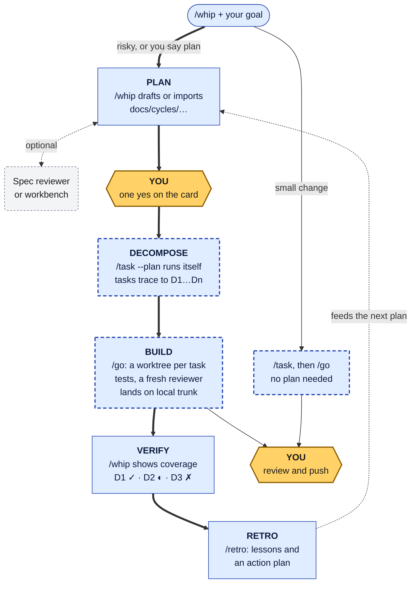

# ACF Tools

Claude Code plugins that let agents plan, build and land code in your git repository. You approve what
gets built, and you push what lands.

There are seven. The core one, **acf-whip**, runs the whole cycle and commits locally, never pushing.
You approve a plan once. Agents split it into tasks, then build, review and integrate them. A script
checks what landed against the plan, and when something went wrong, a retro writes lessons that feed
the next plan. The other six are optional helpers.

Proprietary: any use beyond reading the source, including installing it, needs a [license](#acknowledgements-and-license) from Fibonacci Seven. Requires Claude Code 2.1.154 or later.

[Quick start](#quick-start) · [How a cycle works](#how-a-cycle-works) · [What's in the box](#whats-in-the-box) · [Principles](#principles) · [FAQ](#faq)

## The cycle at a glance

<!-- Mermaid label rules: quote every label; no <...> placeholders (Mermaid strips them silently), no bare parentheses, no "[/", no node id "end"; write a quote as #quot;; label lines under 27 characters, 12 nodes max. Validated on Mermaid 10.9 and 11.x, light and dark. -->


Amber hexagons are yours. Blue dashed boxes run as background workflows; the gray dashed box is
optional. Thick arrows trace a planned cycle, D1…Dn are the plan's deliverables, and trunk is the
branch you have checked out. In words: **planned** is `/whip "<goal>"` → `yes` → `/go` → `/whip` →
`/retro`. **Small** is `/whip "<goal>"` → `/task "<goal>"` → `/go`.

**You only need to remember `/whip`.** Run it bare and it reports where you are and prints exactly
one command to run next. Here is real output from a repo where the last task had just landed:

```text
STATUS no active cycle
  idle: name the next goal; small work can go straight to /task "<goal>"

NEED YOU: nothing

NEXT /whip "<goal>"
```

| Good fit | Not a fit |
|---|---|
| A git repo you can let agents commit to on a local branch | Work you cannot review before it is pushed |
| Features you can state as outcomes with testable criteria | Exploratory spikes with no acceptance criteria yet |
| Teams that want plans, approvals and lessons kept in git | A codebase with no tests and no way to add them |

## Quick start

| You need | Why |
|---|---|
| Claude Code 2.1.154 or later, with workflows on (on Pro, turn them on in `/config`) | `/task` and `/go` run as background workflows. Without workflows, both fall back to an in-chat loop that works only with the files store and does not start by itself on `yes` |
| git, jq, and python3 3.8 or later | Every stage writes to your git history; `/whip` reads the task store with jq; six plugins run Python SessionStart hooks |
| Optional, per feature | `pre-commit` (runs the hooks `/whip-init` installs) · `uv` (acf-advisor) · `bd`; the `multica` CLI with `MULTICA_*`; or `curl` with `LINEAR_API_KEY` and `ACFW_LINEAR_TEAM` (other task stores) · `curl` and `GAPTRAP_API_KEY` (the GapTrap spec tool) |

### 1. Install

The repository is private: you need a license and read access to it. Then, in Claude Code:

```shell
/plugin marketplace add fib7/acf-tools
/plugin install acf-whip@acf-tools
/plugin install acf-librarian@acf-tools
```

From a local clone, replace the first line with `/plugin marketplace add ./acf-tools`, run from the
clone's parent directory. acf-librarian is optional: it adds the naming and commit conventions the
generated agents follow. Then run `/reload-plugins` (or restart Claude Code). To check that it loaded,
run a bare `/whip` in the repository you want to work in. The output should end with
`NEXT /whip-init --with-specialists`.

### 2. Set up your repository

Run that `/whip-init` line. It asks a few setup questions, then creates the task store (`.backlog/`),
the agents your stack needs, a pre-commit config and a short `CLAUDE.md` section ([What it writes](#what-it-writes-and-what-leaves-your-machine)).
It does not commit. Commit the new files before your first `/task`, because `/go` builds in worktrees
made from your commits. The pre-commit hooks run only after `pre-commit install`.

### 3. Your first small change

```text
/whip "add a --version flag that prints the version from package.json"
```

```text
Route: small. Adding a `--version` flag doesn't break an existing flag, and it doesn't touch data, auth, three or more modules, or a new user flow. It goes straight to `/task`.

NEXT /task "add a --version flag that prints the version from package.json"

If you want a plan to approve first, reply `plan`.
```

> **Cost.** A task normally runs its own workflow of several agents, even for a one-line change. In a test
> run with Opus 5.5 as the session model, Claude Code reported $1.79 to decompose this flag and $5.06
> to build it (17 agents); the three-task cycle in step 4 took $2.75 and $23.37 (69 agents). Each run
> report lists the models it used and how many agents ran on each; acf-mission-control shows spend live.

1. Run that `/task` line. It decomposes the goal in the background and sets your focus, the list of
   tasks a bare `/go` runs. Wait for its report (about 3 minutes in the test run).
2. Run `/go`. The focus is not an approved plan, so it lists the tasks and asks; reply `yes`.
3. Wait for the run report (about 20 minutes). Keep Claude Code open and edit elsewhere ([why](#how-a-cycle-works)).
4. Six commits land on your checked-out branch (here `main`), none pushed: the task's creation, four
   state changes and one `integrate: <task>` with the code. A bare `/whip` then prints `NEED YOU: nothing`.

### 4. Your first planned cycle

Give `/whip` a goal that is risky or spans three or more modules, or say "plan":

```text
/whip "greet in the user's language: a --lang flag (en, es, fr), a ~/.greetrc file for the default name and language, and README docs for both"
```

It drafts `docs/cycles/<cycle-id>/plan.md` and shows the approval card (trimmed here):

```text
STATUS 20260929-lang-flag-greetrc · draft · feature · "Localized greetings and ~/.greetrc"
...

NEED YOU
  WHAT approve docs/cycles/20260929-lang-flag-greetrc/plan.md "Localized greetings and ~/.greetrc" (3 deliverables)
  RISK nothing is built until you approve, and the approval binds exactly content=36eba4c423af: any later edit needs a new card. Undo: /whip --abandon 20260929-lang-flag-greetrc
  REPLY yes: approve, then start /task --plan in the background (sets your /go focus)
  ...
  ASSUME Precedence, per setting: command line, then `~/.greetrc`, then the built-in default (`world`, `en`).
  ...

NEXT yes: approve docs/cycles/20260929-lang-flag-greetrc/plan.md (content=36eba4c423af)
```

Each `ASSUME` line is a default `/whip` chose for you. To veto one, say so, and it edits the plan and
shows a new card. Reply `yes`. That approves exactly the content on the card and starts `/task --plan`
by itself. When its report arrives, run `/go`. It starts without asking this time, because the focus
is an approved plan. This build took about 95 minutes in the test run.

### 5. Check coverage and close the cycle

The `/go` report ends with coverage per deliverable, and a bare `/whip` shows it again. The cycle
stays `decomposed` until `/retro` closes it:

```text
STATUS 20260929-lang-flag-greetrc · decomposed · feature · "Localized greetings and ~/.greetrc"
  retro: clean: closes instantly, zero agents
  coverage (default mode)
    D1 ✓ `--lang` picks the greeting language: feature-002-lang-flag
    D2 ✓ `~/.greetrc` sets the default name and language: feature-003-greetrc-defaults
    D3 ✓ README documents `--lang` and `~/.greetrc`: docs-004-readme-lang-greetrc

NEED YOU: nothing

NEXT /retro 20260929-lang-flag-greetrc
```

Run `/retro` to close the cycle. Its whole history is in the cycle's `record.md`:

```text
- **Status**: closed
...
- **Approved Content**: v1:36eba4c423af
- **Retro**: none
...
| Date Time | Event | By | Content | Details |
| --------- | ----- | -- | ------- | ------- |
| 2026-09-29 14:49:41 | closed | canary@example.com | 36eba4c423af | retro: none; lessons: 0; actions: - |
| 2026-09-29 13:12:30 | decomposed | canary@example.com | 36eba4c423af | tasks=3; + feature-002-lang-flag(D1) feature-003-greetrc-defaults(D2) docs-004-readme-lang-greetrc(D3) |
| 2026-09-29 13:09:40 | approved | canary@example.com | 36eba4c423af | ds=D1,D2,D3 |
| 2026-09-29 13:07:48 | drafted | canary@example.com | 900970881e54 | /whip draft |
```

If a task was reworked or got stuck, or a deliverable was not met, `/retro` instead writes `retro.md`
and up to three one-rule lessons under `docs/acf/lessons/` that future `/task` runs read. When it
proposes fixes, they come back to you as a follow-up plan with its own approval card.

## How a cycle works

| Stage | You run | You get | Who decides | Runs where |
|---|---|---|---|---|
| Plan | `/whip "<goal>"` or `/whip <plan.md>` | `docs/cycles/<cycle-id>/plan.md` and an approval card | You: one `yes` | Your chat |
| Decompose | nothing: `yes` starts `/task --plan` | Tasks that name the deliverables they build | Agents, checked by a script | Background |
| Build | `/go` | A worktree per task, tests, a fresh reviewer, an `integrate:` commit per task plus state-change commits on your branch | Agents; three rejections park a task for you | Background |
| Verify | `/whip` | Coverage per deliverable: ✓ done, ◐ not finished, ✗ blocked | A script, from git and the task store | Your chat |
| Retro | `/retro` | A closed cycle; when something went wrong, lessons and an action plan | You approve the action plan | Your chat, plus one agent when triggered |
| Ship | `git push`, a pull request | Your code on the remote | You, always | Your terminal |

**Routing.** By default `/whip` sends a goal straight to `/task`. It drafts a plan instead when the
goal touches any of these: data, a schema or a migration; auth, secrets, payments or personal data; a
breaking change to a public contract; three or more modules; a new user flow. Saying "plan" also gets
you one. The full rubric is in [`skills/whip/SKILL.md`](acf-whip/skills/whip/SKILL.md).

**Background workflows.** `/task` and `/go` run as Claude Code workflows: scripts that dispatch many
agents while your chat stays free. Keep the session open until the report arrives; closing it stops
the run, and running `/go` again picks up where it stopped. `/workflows` shows what is running.

While `/go` runs, it lands work into the files of the checkout you started it from. Do your own
editing in another clone, or wait for the report. If a landing overwrites an uncommitted edit, the
report prints a `Recover:` command.

Approval, decomposition and close each land as a `docs(plan):` commit with an `ACFW-Plan-Event`
trailer, so `git log -- docs/cycles/` shows the same events as `record.md`.

## When agents stop for you

| Agents stop and ask you when | Agents do not stop for |
|---|---|
| A plan needs approval, including a blocking spec tool's NO-GO, which you can override on the card | A rejection under the three-strike cap |
| A retro's action plan needs approval | A merge conflict (an agent resolves it) |
| Work is parked: blocked at the cap, a missing dependency, a task held in draft, a deliverable marked ✗ | A red test inside a worktree |
| Code is ready to push | Retries inside the tooling, and choices within the acceptance criteria |
| `/go` would run a focus that is not an approved plan (one `yes`) | Advisory reviewer findings, or a spec tool that could not run |

## Going further

**Bring your own plan.** `/whip path/to/plan.md` adopts a plan written anywhere: superpowers, spec-kit,
Claude plan mode or by hand. `/whip` copies it into a cycle folder and leaves your original file
unchanged. Coverage needs `## Deliverables` and `### D1: ...` headings; a plan without them still
runs, with coverage off.

**Plug in a spec reviewer or workbench.** A reviewer checks the plan; a workbench is an outside editor
the plan goes to and comes back from. One committed file in `.acfwhip/spec-tools/` puts a tool on the
approval card, and a linter works as-is, with no wrapper script. `/whip --tools add no-tbd`
commits the file below. It blocks approval while the plan contains TBD, TODO or FIXME, and keeps any
task that contains them in draft:

```text
review=grep -nwE 'TBD|TODO|FIXME' "$ACFW_SPEC_FILE"; test $? -eq 1
at=plan,task
policy=block
timeout=10
```

A file you write yourself (lowercase letters, digits and dashes, no extension) runs after you reply
`run tools` on the card. A paid tool reviews on the first card, then only when you reply `review`.
Spec tools never run inside `/go`. Details: [`spec-tools/README.md`](acf-whip/spec-tools/README.md).

GapTrap, a spec gap analyzer, is the worked example: its findings and questions land on the card, and
`/whip --push` opens the plan in GapTrap, which cannot send edits back yet (the `dir` workbench can).
To set it up, mint a key in GapTrap (Profile, then API keys), put it in your shell profile as
`GAPTRAP_API_KEY` from a separate terminal, restart Claude Code and run `/whip --tools add gaptrap`.

**Teams on a shared board.** Ask `/whip-init` for another task store: beads, multica or Linear (files
is the default). acf-whip keeps your focus per checkout, so a bare `/go` runs only the tasks your
own `/task` made. `/go --all` runs the whole board, and only when you type it. Teams that merge
through pull requests set `ACFW_INTEGRATION_MODE=override` in acf-whip's config file, so `/go` stops
at accepted work.

**Second opinions.** acf-advisor's `/acf-advisor:advisor` asks another model, and `/acf-advisor:board`
convenes a panel of personas in parallel, through any OpenAI-compatible endpoint.

## What's in the box

| Plugin | What it does | Cycle stage | Runs | Install it if | Needs |
|---|---|---|---|---|---|
| **acf-whip** | Plans, tasks, orchestrated build, coverage, retro | All | On demand | Always: it is the core | git, jq, python3 |
| **acf-librarian** | Naming and folder conventions, injected every session; audit command | Plan, Retro | Always on | You want consistent docs and commits | python3 |
| **acf-mission-control** | Two-line status bar: context window left, cost including subagents, rate limits | All | Always on | You watch cost and context | python3 |
| **acf-advisor** | Second opinion from another model; persona panels | Plan | On demand | You have an OpenAI-compatible endpoint | uv |
| **acf-challenger-mode** | Makes Claude attack gaps and contradictions in specs | Plan | Always on | You write specs and want them attacked | python3 |
| **acf-arazor-mode** | Makes Claude state readiness as yes or no, with evidence | Build, Ship | Always on | You report status or deploy | python3 |
| **acf-nitro** | Flags sequential work that could run in parallel | Build | Always on | You care about wall-clock time | python3 |

Only acf-whip is required. A plugin that can use another checks whether it is installed and falls
back when it is not. The three modes (challenger, arazor, nitro) change how Claude talks in every
session, so pick at most one.

## Commands at a glance

| Command | What it does |
|---|---|
| `/whip` | Where you are, and the one command to run next. With a goal, a plan file or a cycle id: routes, drafts, shows the approval card |
| `/whip-init` | Sets up a repository: task store, agents, quality gates |
| `/task "<scope>"` · `/task --plan <cycle-id>` | Decomposes a goal, or an approved plan, into tasks |
| `/go` | Builds, reviews and integrates your focus in the background. `/go --all` or `/go <ids>` to choose |
| `/retro` | Closes a cycle: nothing to do when clean, lessons and an action plan when not |
| `/whip-doctor` | Checks backlog and worktree integrity; `--fix` repairs what it safely can |
| `/whip-focus` · `/whip-move` | Edits what a bare `/go` runs · moves one task between states |
| `/whip-add-agents` · `/research` | Generates specialist agents · researches a topic into a document and a task |
| `/audit-acf-conventions` · `/commit` | acf-librarian: reports naming and layout problems (`--fix` repairs them) · stages and commits in conventional-commit form |
| `/acf-advisor:advisor` · `/acf-advisor:board` | acf-advisor: one second opinion, or a panel. Claude Code has its own `/advisor`, so use the prefix |

`whip-go`, `whip-task`, `clean-checkout-before-task` and `integrate-lpcas` are internals behind `/go`
and `/task`; you never call them directly.

## What it writes, and what leaves your machine

| Path | Written by | In git? | To remove |
|---|---|---|---|
| `.backlog/` | acf-whip (files store) | Yes | Delete the folder |
| `.backlog/.acfw-config` (files store) or `.acfwhip/config` (other stores); `.acfwhip/spec-tools/` | `/whip-init`, `/whip --tools add` | Yes | Delete the files. Never keep both config files: `.acfwhip/config` hides every key in the other |
| `.acfwhip/integrated/` | `/go`: one marker per landed task, in the same commit as its code | Yes | Keep while you use acf-whip: it is how `/go` and `/whip` know what landed |
| `.worktree/`, `worktree/<slug>` branches | `/go`, one per task group | No (gitignored) | `/whip-doctor --fix` removes finished ones |
| `.acfwhip/run/`, `.acfwhip/specs/`, `.backlog/.acfw-run.json` | Runs: locks, focus, cycle state, frozen plan copies, spec-tool results | No (gitignored) | Leave it; deleting it drops your focus and cycle state, and a paid spec tool bills again |
| `docs/cycles/<cycle-id>/` | `/whip` drafts or imports `plan.md`, yours to edit; only the tooling writes `record.md`; `/retro` writes `retro.md` | Yes, from approval on (a draft stays untracked) | Never rename or move a cycle folder; `/whip --abandon` closes one |
| `docs/acf/lessons/`, `docs/retrospectives/`; `docs/research/` | `/retro`; `/research` | Yes | `git rm` a lesson to retire it; delete the rest |
| `.claude/agents/`, `docs/agents/`, `docs/development/`, `CLAUDE.md` section, `.pre-commit-config.yaml`, `.worktreeinclude`, `.gitignore` lines | `/whip-init`, `/whip-add-agents` | Yes | Delete the files; edit the lines out |
| `docs/acf/` (except `lessons/`) | acf-librarian's and acf-whip's session-start hooks, and `/whip-init`; an unedited hook-managed copy is refreshed on session start, so commit the refresh | Yes | Delete; the hook-managed ones come back while the plugins are installed |
| `.claude/scripts/status-line.py` (and a `.bak` after an upgrade), the `statusLine` block in `.claude/settings.json` | acf-mission-control, on session start | Your choice: the plugin never commits them | Delete the script and remove the `statusLine` block; both survive uninstalling the plugin |

| Leaves your machine | When |
|---|---|
| Your prompt and the context it assembles, to your endpoint (api.openai.com when no base URL is set) | acf-advisor, when you call it |
| A daily GET of LiteLLM's public price table from raw.githubusercontent.com (`price_map: False` turns it off) | acf-mission-control |
| Task reads and writes to your board | acf-whip on the multica or Linear store (beads keeps its database in `.beads/` in your repo) |
| Your research topic, to the MCP servers you have set up (Perplexity, Context7, Figma) | `/research` |
| Downloads of hook code from github.com | pre-commit, the first time it runs the config `/whip-init` installed |
| The plan text (and task documents, for `at=task`), to wherever the declared tool sends it; GapTrap's host is `GAPTRAP_MCP_URL`, default app.gaptrap.ai | A spec tool you declared and trusted. The committed declaration is the consent |

`/go` never pushes. Pushing is yours.

## Principles

1. **Humans govern, agents execute.** You approve plans and ship code; agents do the rest.
2. **Knowledge is the product.** Plans, lessons and conventions live in git, next to the code.
3. **Route by risk.** Small work runs direct; risky work gets a plan and one approval.
4. **Evidence over claims.** A task counts as landed only when its marker under `.acfwhip/integrated/` is committed on your branch; an approval counts only when its content hash matches the plan at HEAD.
5. **Tighten automatically, loosen only by hand.** Retros may add checks; only you remove one.

## FAQ

**Why does `/whip` say wait?** A run or a decomposition holds a lock in your checkout. If it is still
going, wait for its report. If its session ended, the card under NEED YOU shows the lock's age and the
`rm` that clears it. Run that, then rerun the `/go` or `/task --plan`; it picks up where it stopped.

**How do I stop, pause or watch a run?** `/workflows` lists running workflows. Open one: `x` stops it,
`p` pauses and resumes it.

**What does it cost?** More than the task size suggests; see the [cost note](#3-your-first-small-change).
To pin cheaper models, set `ACFW_MODEL_SHELL`, `ACFW_MODEL_JUDGE` or `ACFW_MODEL_AUTHOR` in the config
file `/whip-init` made (`.backlog/.acfw-config` on the files store). Specialists and reviewers use the
`model:` in their `.claude/agents/<name>.md`.

**How do I update?** `/plugin marketplace update acf-tools`, then `/reload-plugins` or restart.

**How do I uninstall?** `/plugin uninstall acf-whip@acf-tools`. Files it wrote stay in your repo; the
[table above](#what-it-writes-and-what-leaves-your-machine) says how to remove each.

**What if a command is missing or clashes with another plugin?** Every plugin command also works with
its plugin prefix, for example `/acf-whip:whip` or `/acf-whip:go`.

**How do I know an agent did not approve its own plan?** The card prints `content=`, a hash of the
plan text. Your `yes` passes it to `approve`, which refuses it once the plan has changed. But `approve`
cannot tell a hash you saw from one an agent computed. The one guard against that is the skill's rule
to approve only on your reply. `record.md` logs the git identity behind each approval, and the approval
commit carries an `ACFW-Plan-Event` trailer.

**How do I undo an approval?** `yes` starts `/task --plan` at once, so first stop it in `/workflows` if
it is still running. Then run `/whip --abandon <cycle-id>`. Tasks it already made stay pending and in
your focus. Archive each with `/whip-move <task> archive` (`record.md` lists them under `## Tasks`).

**Can I run it headless or in CI?** Yes, with `claude -p`. By default it waits only 10 minutes for
background workflows. Set `CLAUDE_CODE_PRINT_BG_WAIT_CEILING_MS=0` for runs that take longer.

**Where do I report problems?** Open an issue in this repository or write to acf@fib7.ai.

## For maintainers

Instructions for working on this repository are in [`CLAUDE.md`](CLAUDE.md). Turn on the commit hooks
once per clone with `git config core.hooksPath .githooks`. After pushing a release, run
`/plugin marketplace update acf-tools` and restart. Version history lives in the `CHANGELOG.md` of
acf-whip, acf-librarian, acf-mission-control and acf-arazor-mode, for example [acf-whip](acf-whip/CHANGELOG.md).

## Acknowledgements and license

The cycle borrows its sequencing and presentation from [the-gibson](https://github.com/The-AIE/the-gibson)
and ideas about compounding lessons from [Compound Engineering](https://github.com/EveryInc/compound-engineering-plugin).
The GapTrap spec tool talks to [GapTrap](https://gaptrap.ai).

Proprietary License. Copyright 2025 Fibonacci Seven, LLC. The source is available for viewing only;
installing or running it, commercially or not, needs a written license. See [`LICENSE`](LICENSE) and
the LICENSE file in each plugin. Contact: acf@fib7.ai.
